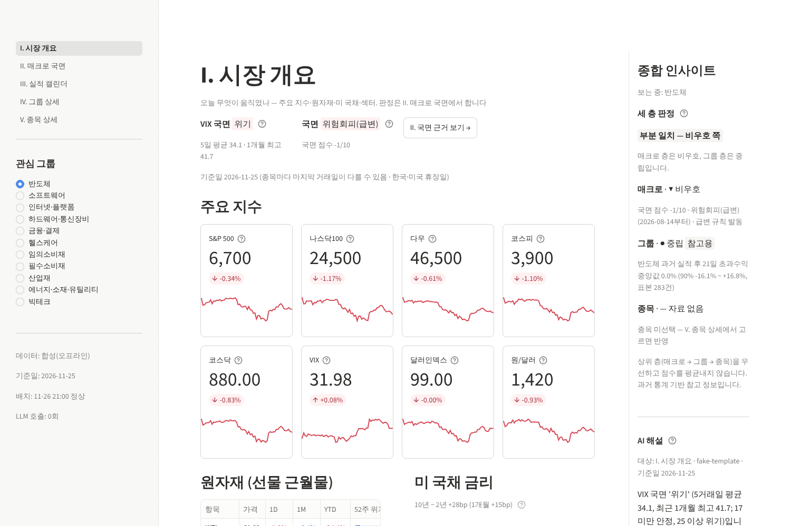
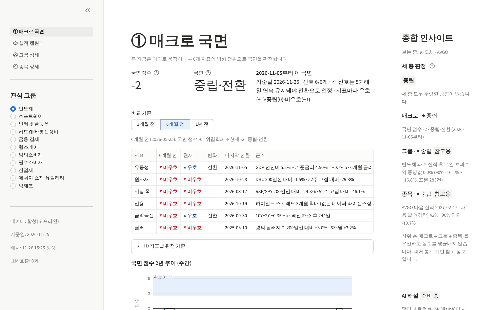
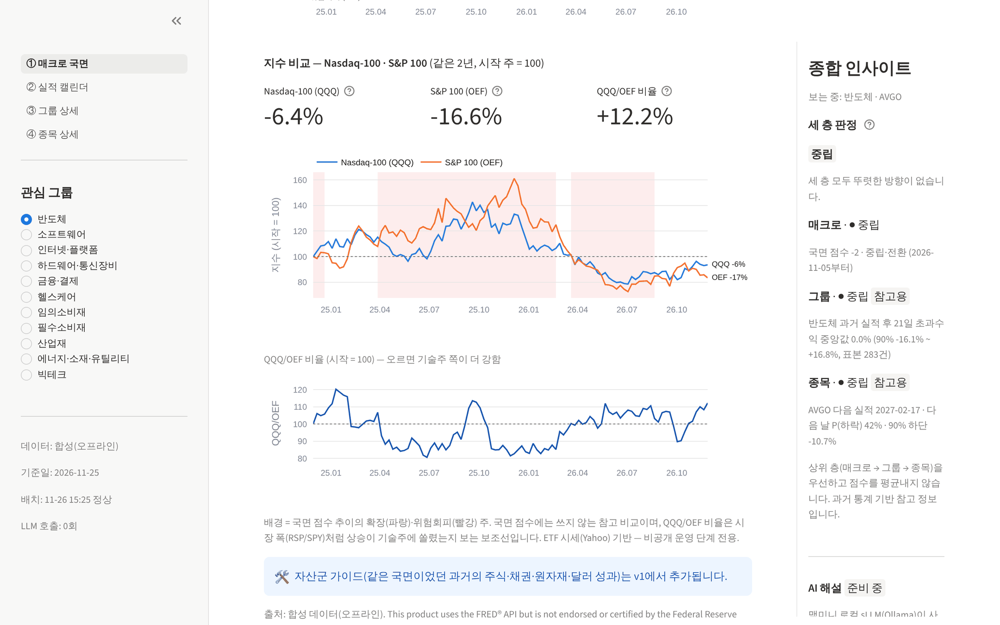
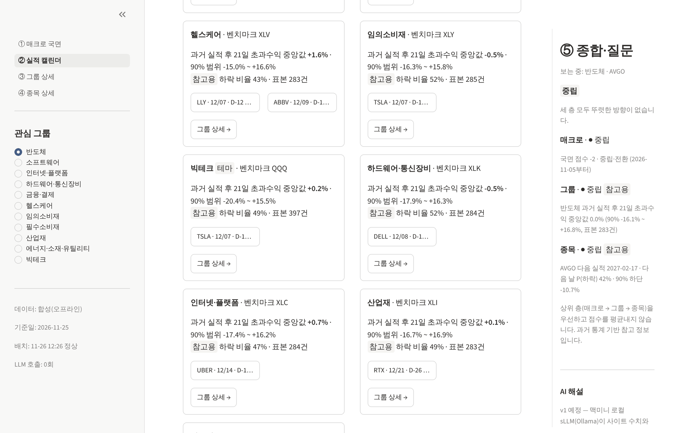
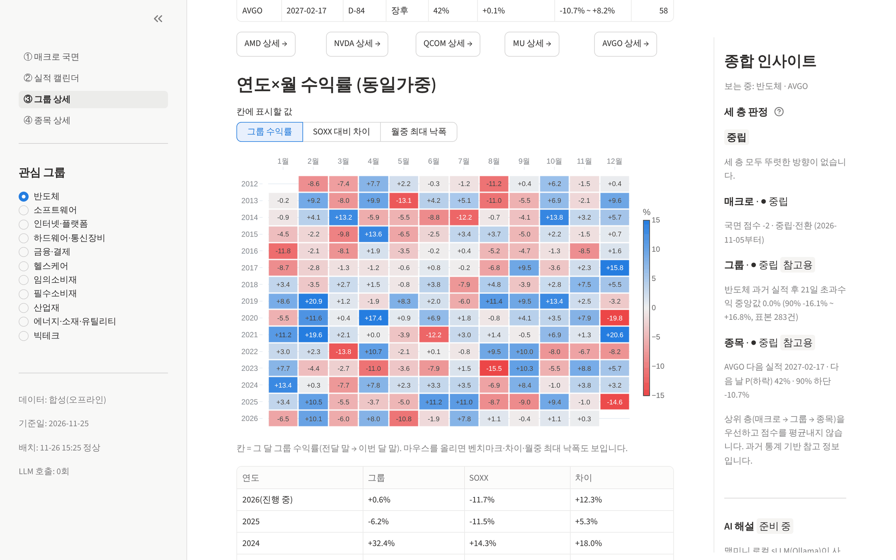
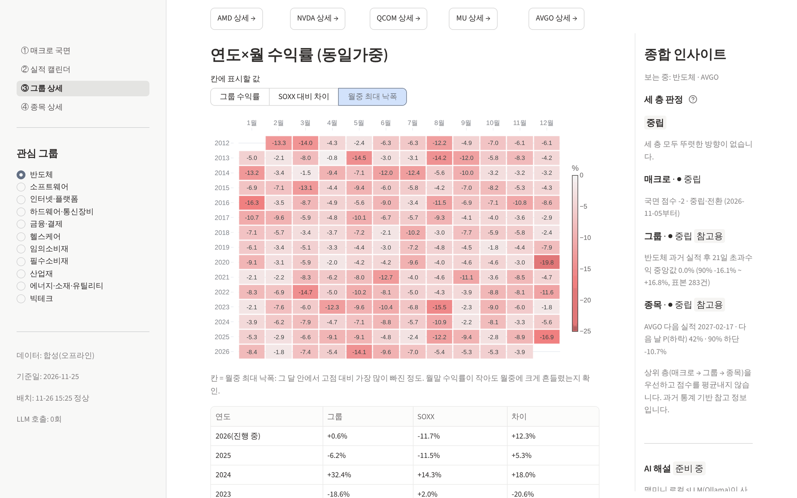
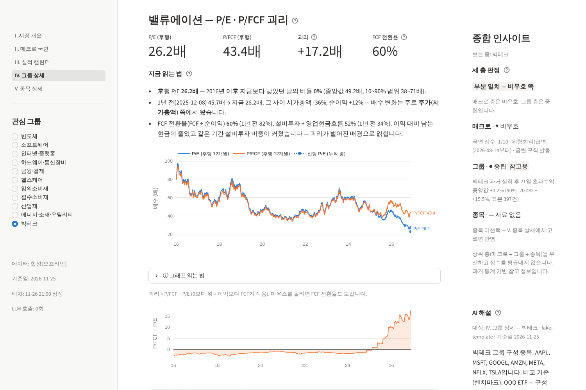
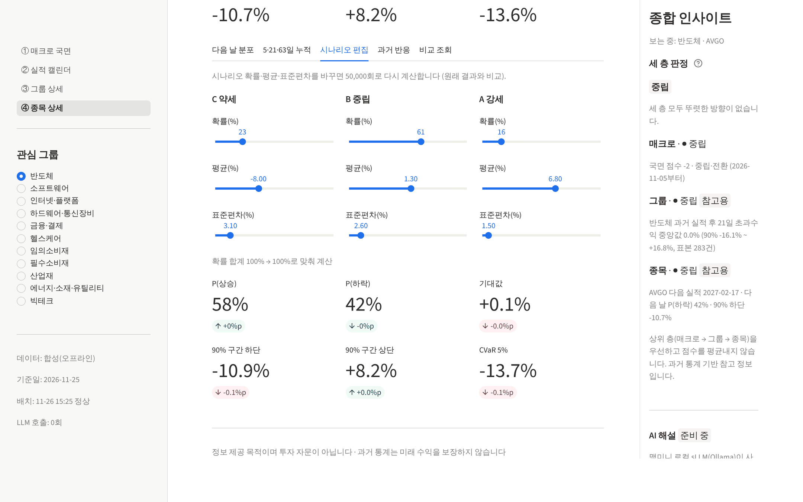
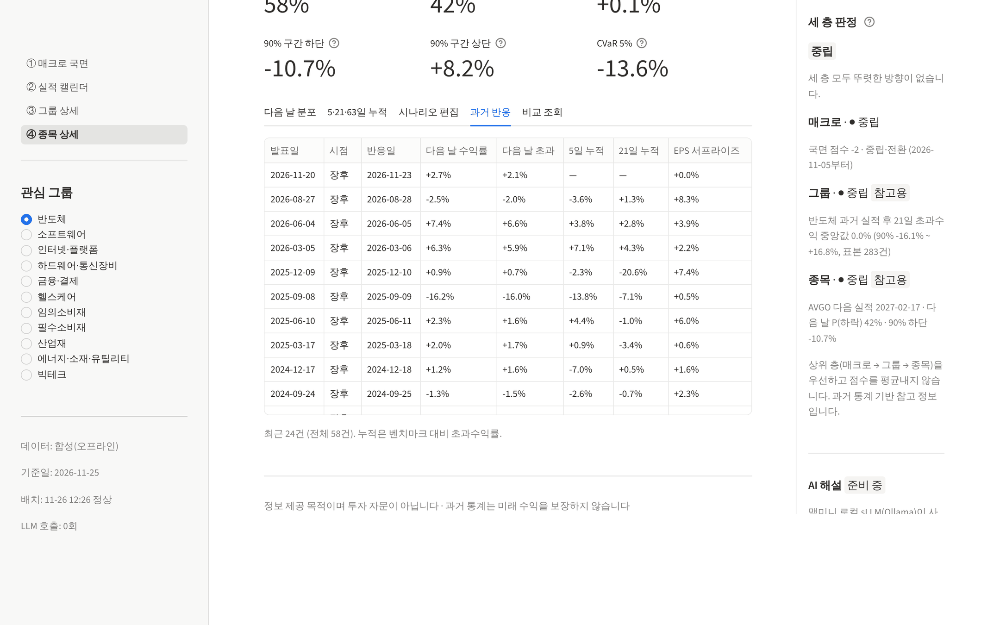

# market_portfolio

실적 반응 시뮬레이터 · 매크로 국면 대시보드 — **market.sielain.com** (S0 비공개 운영)

- 기획: [PLAN.md](PLAN.md) · Claude Code 맥락: [CLAUDE.md](CLAUDE.md)
- 운영 구성·배포 기록: `khselect/sielain.com`의 `docs/market-subdomain-deploy.md`, `log.md`

```
맥북·휴대폰 브라우저 → Cloudflare Access(이메일 일회용 코드) → sielain-tunnel → market_frontend:8501 (맥미니)
```

- **처음 사용한다면**: [사용 설명서](docs/user-guide.md) — 화면별 읽는 법과 따라 해 보는 예시
- **직접 만져 보며 이해하기**: [인터랙티브 가이드](docs/interactive-guide.html) — 브라우저에서 바로 열리는 단일 HTML (국면 점수 계산기·반응 분포 시뮬레이터·종합 판단 연습)

## 화면 둘러보기

> 아래 캡처는 **합성 데이터(오프라인 모드)** 로 찍었습니다. 숫자는 예시이며 실제 시세와 무관합니다. 운영 화면은 매일 07:15 KST 배치가 계산한 실데이터를 보여줍니다.

화면은 세로 3분할입니다 — **왼쪽** 메뉴·관심 그룹·데이터 상태 | **가운데** 화면 I~V | **오른쪽** 종합 인사이트 패널(항상 표시, 스크롤해도 고정). 순서는 큰 흐름에서 개별 종목으로 내려가는 탑다운입니다.

| 화면 | 답하는 질문 | 주요 기능 |
|---|---|---|
| I. 시장 개요 | 오늘 무엇이 움직였나 | 주요 지수 8개(S&P500·나스닥100·다우·코스피·코스닥·VIX·달러인덱스·원/달러) 카드와 60일 추이, 원자재 선물 6개, 미 국채 1~30년 수익률곡선(현재·1개월 전·1년 전)·장단기 금리차, 섹터 ETF 11개 기간별 히트맵, **VIX 국면 배지**(안정·보통·위기). [market_monitor](https://github.com/khselect/market_monitor)의 패널 4개를 옮김 |
| II. 매크로 국면 | 큰 자금은 어디로 움직이나 | **두 속도 국면 점수**(−10~+10): 매크로 층 6개(5거래일 확정) + 시장 층 4개(VIX·추세·낙폭·섹터 폭·단기금리 변동, 2거래일 확정), **급변 규칙**(VIX ≥ 30 또는 나스닥100 −20%), **지표별 기여 막대(왜 몇 점인가)**, 층별 2년 추이, **과거 하락 구간 탐지 검증**(6개 안 vs 10개 안), 비교 기준 3·6·12개월 전, 지표별 마지막 전환일·근거 수치, 2년 추이, **Nasdaq-100·S&P 100 비교와 QQQ/OEF 비율** |
| III. 실적 캘린더 | 이번 달 누가, 어느 그룹이 발표하나 | 기간 2·4·12주, 그룹 카드(과거 실적 후 21일 초과수익 중앙값·90% 범위·하락 비율), 종목 칩 → V, 그룹 상세 → IV |
| IV. 그룹 상세 | 이 그룹은 실적 시즌에 어떻게 움직였나 | 실적일 기준 누적 초과수익률(CAR) −5~+63일, 21일 요약 카드, 다가오는 발표 표·바로가기, 연도×월 히트맵(**그룹 수익률 / 벤치마크 대비 / 월중 최대 낙폭** 전환, 마우스 올리면 세 값 모두), 연도별 그룹·벤치마크·차이, **밸류에이션 P/E·P/FCF 괴리**(후행 12개월 + 선행 P/E 누적) |
| V. 종목 상세 | 다음 실적에 어떻게 반응할까 | 다음 실적일·D-day, 확률 카드 6개(P(상승)·P(하락)·기대값·90% 구간 하단·상단·CVaR), 탭 5개(분포·누적·시나리오 편집·과거 반응·비교 조회) |
| 종합 인사이트 (오른쪽 패널) | 지금 보는 것을 세 층으로 겹치면 | 보는 중(그룹·종목), 일치·충돌 배지, 매크로→그룹→종목 층별 판정과 근거, AI 해설(로컬 sLLM 미리 생성, 근거 대조) |

### I. 시장 개요

- 맨 위 **VIX 국면**(5거래일 평균: 안정 < 17 ≤ 보통 < 25 ≤ 위기)과 II. 국면 배지, "II. 국면 근거 보기" 버튼
- 주요 지수 카드: 1일 등락 + 60일 추이(VIX는 오르면 불안이라 색을 반대로), 원자재 표(1D·1M·YTD·52주 위치·60일), 미 국채 수익률곡선과 bp 변화, 섹터 히트맵(▲ 200일선 위 — 이 비율이 II. 시장 층의 '섹터 폭')
- 수치만 보여주고 판정은 II이 한다. 지수·선물 시세는 Yahoo 기반이라 비공개 운영 단계 전용

### II. 매크로 국면

- 맨 위 **국면 점수**(−10~+10)와 **국면**(확장 ≥ +4 · 중립·전환 · 위험회피 ≤ −4 · **위험회피(급변)**), 매크로 층·시장 층 점수, 이 국면이 시작된 날
- **왜 몇 점인가** 막대: 지표 10개가 각각 +1·0·−1 중 무엇으로 기여했는지, 마우스를 올리면 지금 값
- **급변 규칙**: VIX ≥ 30 또는 나스닥100 고점 대비 −20% 이하면 점수와 관계없이 위험회피(급변) — 느린 매크로 지표가 버텨 점수가 0 근처에 머무는 급락장을 놓치지 않기 위해 (v0.21). 해제는 VIX 25 미만·나스닥100 −15%보다 회복이 5거래일 연속일 때만 — 빨리 들어가고 천천히 나오기 (v0.22)
- **비교 기준**을 바꾸면 표의 왼쪽 열(3·6·12개월 전 신호)과 "변화" 열이 바뀐다 — 수준보다 **방향 전환**을 보는 화면
- 표의 **근거** 열에 판정에 쓴 실제 수치. 신용(하이일드 스프레드)은 데이터 라이선스상 값 대신 방향만


- 주간 국면 점수 추이. 막대 = 층별 점수(하늘색 매크로 층 · 주황 시장 층), 선 = 합계. 파란 띠 = 확장, 연한 빨강 띠 = 위험회피, 진한 빨강 세로띠 = 급변 규칙 발동 주
- **검증** 펼치기: 2007년 이후 S&P 500이 52주 고점 대비 15% 넘게 빠진 구간마다 기존안(6개·±3), v0.21(10개·±4+급변 즉시 해제), 현재안(급변 해제 히스테리시스)이 — 헛 위험회피 일수는 반등 지연(저점 뒤 63거래일)과 순수 헛경보로 나눠 — 며칠 만에 위험회피로 바뀌었는지(−10% 도달일 대비), 오경보(위험회피 진입 뒤 63거래일 낙폭 −7%보다 얕음) 연간 횟수


- **Nasdaq-100(QQQ)·S&P 100(OEF)** 를 같은 2년·같은 날짜축에, 시작 주 = 100으로 한 축에 그림. 배경 = 국면 점수의 확장(파랑)·위험회피(빨강) 주 — 국면이 바뀔 때 지수가 어떻게 움직였는지
- **QQQ/OEF 비율**: 오르면 기술주 쪽이 대형주 전체보다 강함 (상승이 기술주에 쏠렸는지 보는 보조선, 국면 점수에는 안 씀)
- ETF 시세(Yahoo) 기반이라 비공개 운영 단계 전용

### III. 실적 캘린더

- 기간 안에 발표가 있는 그룹만 카드로, **가장 먼저 발표하는 그룹이 위**
- 칩 `PG · 12/04 · D-9 장후` → 누르면 V로 이동, 마우스를 올리면 다음 날 P(하락)·90% 구간
- 카드의 숫자는 **그 그룹의 과거 실적 시즌 통계**(참고용) — 다가오는 실적의 예측이 아님

### IV. 그룹 상세

- 실적 반응일(0)을 기준으로 정렬한 **누적 초과수익률(CAR)**: 진한 선 = 평균, 옅은 띠 = 이벤트 25~75%
- 다가오는 발표 표에서 종목별 P(하락)·기대값·90% 구간, 버튼으로 V. 이동


- 칸마다 값이 적혀 있어 색만으로 읽지 않아도 된다(파랑 상승 · 빨강 하락 · ±15%에서 가장 진함)
- **칸에 표시할 값** 전환: 그룹 수익률 / 벤치마크 대비 차이(%p) / **월중 최대 낙폭**. 마우스를 올리면 세 값과 벤치마크 수익률이 함께 보임
- 아래 표: 연도별 그룹·벤치마크·차이 (올해는 "진행 중")


- 칸 값은 **전달 말 → 이번 달 말** 한 번의 변화라, 월중에 크게 빠졌다 반등한 달을 가린다 → "월중 최대 낙폭"으로 그 달 안의 고점 대비 최대 하락을 확인 (예: 월수익 −5%여도 월중 −22%)



- **P/E·P/FCF 괴리**: 그룹 시가총액 합 ÷ 순이익 합(P/E), ÷ FCF 합(P/FCF). 두 선이 벌어지면 **이익만큼 현금이 남지 않는다**는 뜻(예: 설비투자 급증) — 아래 그래프의 괴리(P/FCF − P/E)와 FCF 전환율로 확인
- **지금 읽는 법**(계산값을 고정 문장에 넣은 서술, AI 미사용): 지금 P/E가 2016년 이후 분포에서 어디쯤인지, 1년 전 대비 배수 변화가 **주가 쪽인지 이익 쪽인지**(log P/E = log 시가총액 − log 이익), FCF 전환율·설비투자 비중의 1년 변화. **ⓘ 그래프 읽는 법** 펼치기, 점선 세로선 = 재무 확보 종목 수가 바뀐 날(그날의 계단은 구성 변화)
- **종목별 표**: 최근 분기(지금 배수에 반영된 분기 말)와 **상태**(재무 받은 날 + 적자·FCF 음수·FCF가 이익의 절반 미만·설비투자가 영업현금의 절반 이상·최근 분기 미반영 같은 계산상 주의점, 판정 아님)
- **과거 비슷한 수준이었을 때**(서술 통계): P/E·괴리가 지금과 비슷한 백분위(±10%p, 그날까지 이력 기준)였던 날들 이후 3·12개월 그룹 수익률 중앙값·상승 비율·90% 구간을 **전체 기간과 나란히**, 겹치지 않는 **독립 구간 수**와 함께. 읽기 배지는 전체 기간 대비(과거 강세 우위 / 과거 약세 우위 / 뚜렷한 차이 없음), 독립 구간 20개 미만이면 참고용 — 진입 판단·권유가 아님
- 후행 12개월(TTM) 기준이며 분기 실적은 분기 말 45일 뒤부터 반영. Bloomberg식 **선행 P/FCF는 무료 데이터에 없어** 선행 P/E만 오늘부터 매일 누적(점선)
- 재무제표는 Alpha Vantage 무료 한도(하루 25회) 때문에 매일 20회씩 나눠 받음 — 빅테크·반도체 우선, 50종목 전체는 약 5일. 표의 "수집 대기"는 아직 안 받은 종목

### V. 종목 상세

- 맨 위 다음 실적일(장전/장후)·D-day, 표본 수·기간·기준일·"참고용" 배지
- 확률 카드: **손실 쪽 숫자(90% 하단·CVaR)를 기대값과 같은 크기로**
- 분포 히스토그램: 빨강 = 하락 구간, 파랑 = 상승 구간, 점선 = 5%·95% 위치. 아래 표 = 3개 시나리오(약세·중립·강세)

| 탭 | 화면 |
|---|---|
| 5·21·63일 누적 |  실적 후 63거래일까지 누적 초과수익 범위(팬 차트)와 기간별 표 |
| 시나리오 편집 |  세 시나리오의 확률·평균·표준편차를 바꾸면 5만 회 다시 계산, 원래 값 대비 변화(%p) |
| 과거 반응 |  최근 24건: 발표일·장전/장후·반응일·다음 날 수익률·초과수익·5·21일 누적·EPS 서프라이즈 |
| 비교 조회 |  다른 종목과 핵심 수치를 한 표로 |

### 종합 인사이트 (오른쪽 고정 패널)


- **보는 중**: V에서는 선택한 종목과 그 산업 그룹, 다른 화면에서는 사이드바 관심 그룹(+ 마지막으로 본 종목이 그 그룹이면 함께)
- **배지**: 일치(파랑 우호 / 빨강 비우호) · 충돌(주황) · 부분 일치 · 중립
- **층별 판정** (규칙 기반, LLM 미사용)
  - 매크로: 국면 점수 ≥ +3 우호, ≤ −3 비우호
  - 그룹: 과거 21일 CAR 중앙값 ±0.5% 밖이면 그 방향 (참고용)
  - 종목: P(하락) ≥ 60% 또는 90% 하단 ≤ −15% → 비우호, P(상승) ≥ 60% 이고 하단 > −15% → 우호
- 상위 층을 우선하고 점수를 평균내지 않는다 — 충돌을 숨기지 않기 위해
- AI 해설(F20 1단계): 매일 배치가 맥미니 로컬 sLLM(Ollama gemma3:12b)으로 화면별 해설을 미리 씁니다. 답변 속 숫자·날짜를 근거와 코드로 대조해 맞지 않으면 버리고 근거 요약을 보여줍니다. 페이지 조회당 LLM 호출 0.
- **질문하기**(F20 2단계): 패널 아래 입력창에 지금 보는 화면에 대해 질문하면 로컬 qwen3:8b(기본, 11-28 ai-bench로 gemma3:4b에서 교체)가 그 화면의 수치와 관련 용어 설명만 근거로 답합니다. 매수·매도·비중·목표가 질문은 AI를 부르지 않고 안내, 답의 숫자·날짜(질문에 나온 숫자 포함)를 코드로 대조해 실패하면 1회 재시도 뒤 근거 일부로 대신, 검증 전 문장은 보여주지 않음(스트리밍 안 함). 세션 제한 없음(S0 본인 전용, 공개 시 하루 10회)·전체 하루 600회·동시 1건+대기 3건, 질문 기록은 이메일·전화번호를 지우고 저장(3단계 평가용). **답변 모델 선택**: 맥미니에 설치된 qwen3:8b(기본)·gemma3:4b·qwen2.5:7b-instruct 중 고름(qwen3는 생각 모드를 끄고 호출, 기본 아닌 모델은 5분만 상주)
- **비교 질문**: "2026년 수익률이 10년 평균보다 높았어?", "몇 번째야?", "국면 점수가 최근 2년 중 낮은 편이야?" 같은 질문은 평균·순위·높음/낮음을 **코드가 미리 계산한 비교 문장**(IV: 같은 기간 비교·순위·벤치마크 이긴 해, II: 2년 중 위치·국면 지속·VIX 1년 중 위치)을 근거로 답합니다 — 모델이 숫자를 계산하지 않으므로 추론 모드가 필요 없음
- **모델 비교** `python -m pf.jobs.run ai-bench --models gemma3:4b,qwen2.5:7b-instruct,qwen3:8b`: 같은 근거·같은 검증으로 해설 n건 + 고정 질문 15개(`config/ai_questions.yaml` — 답해야 할 것·근거 밖·범위 밖)를 돌려 첫 시도 통과율·기대 일치율·탈락 사유·시간 비교

<br clear="right">

## 운영 방식 (parts.sielain.com과 동일)

- 운영 컨테이너는 **`/Users/sielain/docker`(sielain.com 저장소) compose의 `market-app` 서비스**로 띄운다.
- `/docker/market-app`은 맥미니의 이 폴더를 가리키는 symlink다.
- 이 폴더의 `docker-compose.yml`은 **로컬 개발 전용**이다 (`market_dev`, 8503, 터널 미연결).

## 1. 맥미니 최초 설정 (1회)

`<python_projects 클론 경로>`는 맥미니에서 이 저장소를 클론한 위치로 바꿔 읽습니다.

```bash
cd ~/docker && ln -s <python_projects 클론 경로>/market_portfolio market-app
```

```bash
cp ~/docker/market-app/.env.example ~/docker/market-app/.env
```

```bash
cd ~/docker && docker compose up -d --build market-app
```

```bash
curl -s http://127.0.0.1:8502/_stcore/health
```

`ok`가 나오면 Cloudflare 라우트를 추가합니다 (Access 애플리케이션은 2026-11-26 생성 완료):
Zero Trust → Networks → Tunnels → `sielain-tunnel` → **Published application routes** → Subdomain `market` / HTTP / `market_frontend:8501`.
맥북 시크릿 창에서 https://market.sielain.com → Cloudflare 로그인 화면이 뜨면 정상입니다.

## 2. 실적 반응 계산 (V. 종목 상세)

`market-app/.env`에서 `PF_OFFLINE=0`으로 바꾸면 실데이터(yfinance, S0 개인 분석용)로 계산합니다. 바꾼 뒤 컨테이너를 다시 만듭니다.

```bash
cd ~/docker && docker compose up -d market-app
```

```bash
docker compose exec market-app python -m pf.jobs.run publish --group semis
```

```bash
docker compose exec market-app python -m pf.jobs.run show AVGO
```

실적 발표 **전에** 예측을 기록합니다 (같은 실적·기준일 기록은 덮어쓰지 않음):

```bash
docker compose exec market-app python -m pf.jobs.run record AVGO
```

결과는 `market-app/data/publish/ticker/*.json`, 기록은 `market-app/data/predictions/`에 남습니다. 화면은 JSON만 읽으므로 계산 후 새로고침하면 반영됩니다.

### 매일 자동 계산 (`market-jobs`)
매일 07:15 KST에 산업 그룹 10개(50종목)를 다시 계산하고, 실적이 1~5일 남은 종목은 예측을 자동 기록합니다. 사이드바 "배치:" 줄에 마지막 실행 결과가 보입니다.

```bash
docker logs --tail 20 market_jobs
```

## 3. 업데이트

- **어디서든 push만 하면 된다.** 맥미니의 auto-deploy(launchd 5분)가 이 저장소의 upstream을 받아 `market_portfolio/`가 바뀐 경우에만 재빌드한다 (sielain.com `scripts/auto-deploy.sh`).
- 바로 반영: 맥미니에서

```bash
cd <python_projects 클론 경로> && git pull && cd ~/docker && docker compose up -d --build market-app
```

- `config/*.yaml`만 바꾼 경우는 볼륨 연결이라 재빌드 없이 `docker compose restart market-app`.

## 4. 로컬 개발

```bash
pip install -r requirements-dev.txt
```

```bash
pytest -q
```

```bash
PYTHONPATH=src streamlit run app/main.py
```

`PF_OFFLINE=1`(기본)이면 합성 데이터로 동작해 네트워크·API 키가 필요 없습니다. 컨테이너로 확인하려면 이 폴더에서 `docker compose up -d --build` → http://127.0.0.1:8503.

## 5. 지켜야 할 것

- 외부로 가는 경로는 터널 하나뿐. 8502·8503·11434 포트를 공유기에서 열지 않는다.
- `.env`(API 키)는 커밋하지 않는다.
- 맥미니 클론에 미커밋 변경을 남기지 않는다 — auto-deploy가 건너뛴다.
- 공개(S1) 전환은 PLAN.md §9.2 체크리스트를 모두 통과한 뒤, Access 정책 변경이 마지막 단계.
