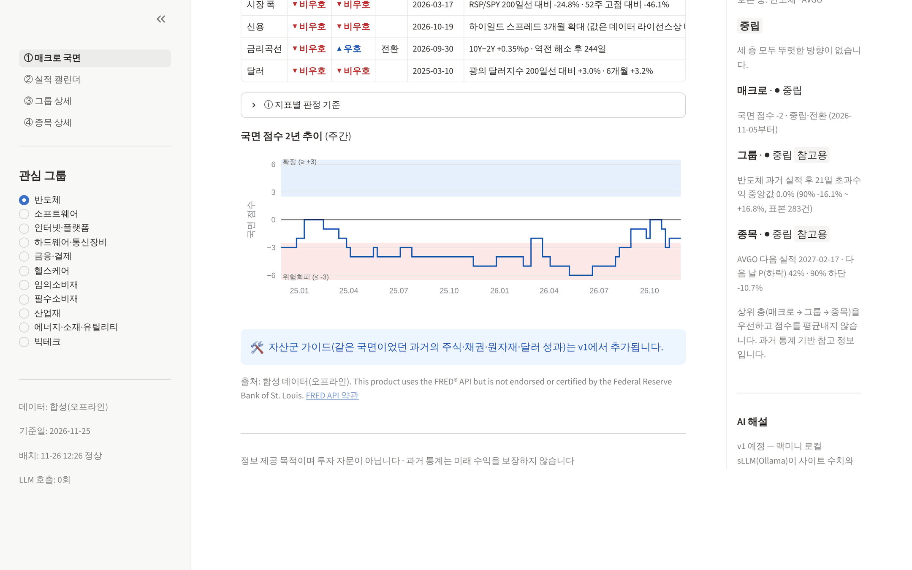
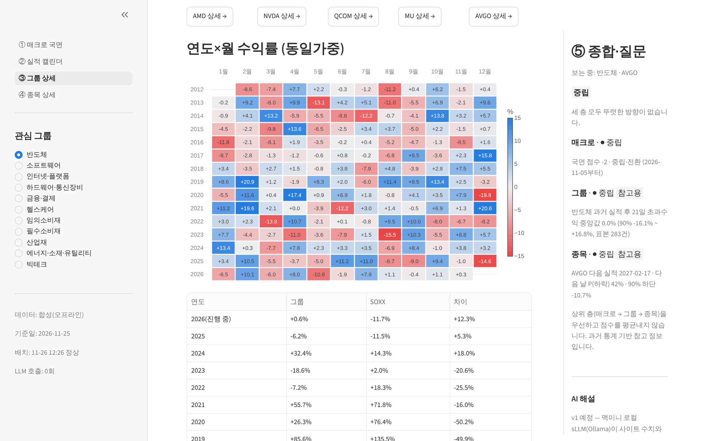
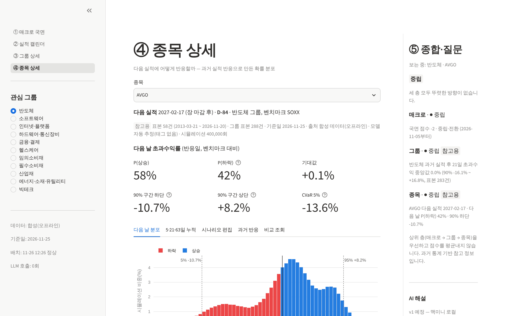
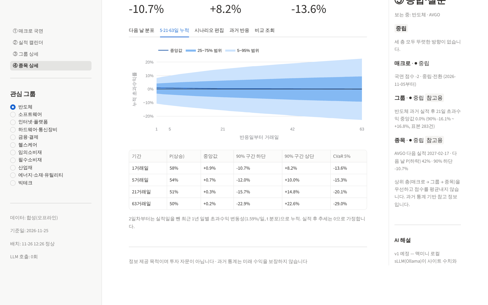
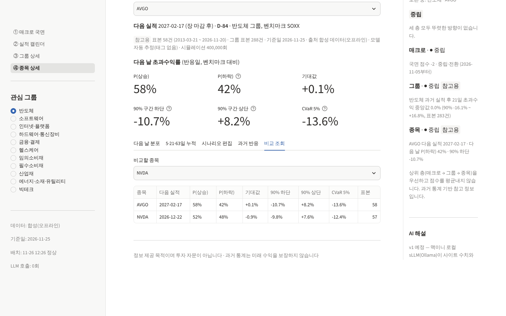
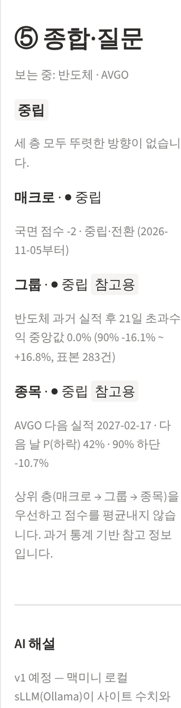

# market_portfolio

실적 반응 시뮬레이터 · 매크로 국면 대시보드 — **market.sielain.com** (S0 비공개 운영)

- 기획: [PLAN.md](PLAN.md) · Claude Code 맥락: [CLAUDE.md](CLAUDE.md)
- 운영 구성·배포 기록: `khselect/sielain.com`의 `docs/market-subdomain-deploy.md`, `log.md`

```
맥북·휴대폰 브라우저 → Cloudflare Access(이메일 일회용 코드) → sielain-tunnel → market_frontend:8501 (맥미니)
```

- **처음 사용한다면**: [사용 설명서](docs/user-guide.md) — 화면별 읽는 법과 따라 해 보는 예시
- **직접 만져 보며 이해하기**: [인터랙티브 가이드](docs/interactive-guide.html) — 브라우저에서 바로 열리는 단일 HTML (국면 점수 계산기·반응 분포 시뮬레이터·종합 판단 연습)

## 화면 둘러보기

> 아래 캡처는 **합성 데이터(오프라인 모드)** 로 찍었습니다. 숫자는 예시이며 실제 시세와 무관합니다. 운영 화면은 매일 07:15 KST 배치가 계산한 실데이터를 보여줍니다.

화면은 세로 3분할입니다 — **왼쪽** 메뉴·관심 그룹·데이터 상태 | **가운데** 화면 ①~④ | **오른쪽** ⑤ 종합·질문 패널(항상 표시, 스크롤해도 고정). 순서는 큰 흐름에서 개별 종목으로 내려가는 탑다운입니다.

| 화면 | 답하는 질문 | 주요 기능 |
|---|---|---|
| ① 매크로 국면 | 큰 자금은 어디로 움직이나 | 6개 지표 우호·중립·비우호 판정(5거래일 확정), 국면 점수(−6~+6)와 국면, 비교 기준 3·6·12개월 전, 지표별 마지막 전환일·근거 수치, 2년 추이 |
| ② 실적 캘린더 | 이번 달 누가, 어느 그룹이 발표하나 | 기간 2·4·12주, 그룹 카드(과거 실적 후 21일 초과수익 중앙값·90% 범위·하락 비율), 종목 칩 → ④, 그룹 상세 → ③ |
| ③ 그룹 상세 | 이 그룹은 실적 시즌에 어떻게 움직였나 | 실적일 기준 누적 초과수익률(CAR) −5~+63일, 21일 요약 카드, 다가오는 발표 표·바로가기, 연도×월 동일가중 히트맵, 연도별 그룹·벤치마크·차이 |
| ④ 종목 상세 | 다음 실적에 어떻게 반응할까 | 다음 실적일·D-day, 확률 카드 6개(P(상승)·P(하락)·기대값·90% 구간 하단·상단·CVaR), 탭 5개(분포·누적·시나리오 편집·과거 반응·비교 조회) |
| ⑤ 종합·질문 (오른쪽 패널) | 지금 보는 것을 세 층으로 겹치면 | 보는 중(그룹·종목), 일치·충돌 배지, 매크로→그룹→종목 층별 판정과 근거, AI 해설 자리(v1) |

### ① 매크로 국면

- 맨 위 **국면 점수**와 **국면**(확장 ≥ +3 · 중립·전환 · 위험회피 ≤ −3), 이 국면이 시작된 날
- **비교 기준**을 바꾸면 표의 왼쪽 열(3·6·12개월 전 신호)과 "변화" 열이 바뀐다 — 수준보다 **방향 전환**을 보는 화면
- 표의 **근거** 열에 판정에 쓴 실제 수치. 신용(하이일드 스프레드)은 데이터 라이선스상 값 대신 방향만


- 주간 국면 점수 추이. 파란 띠 = 확장 구간, 빨간 띠 = 위험회피 구간

### ② 실적 캘린더

- 기간 안에 발표가 있는 그룹만 카드로, **가장 먼저 발표하는 그룹이 위**
- 칩 `PG · 12/04 · D-9 장후` → 누르면 ④로 이동, 마우스를 올리면 다음 날 P(하락)·90% 구간
- 카드의 숫자는 **그 그룹의 과거 실적 시즌 통계**(참고용) — 다가오는 실적의 예측이 아님

### ③ 그룹 상세

- 실적 반응일(0)을 기준으로 정렬한 **누적 초과수익률(CAR)**: 진한 선 = 평균, 옅은 띠 = 이벤트 25~75%
- 다가오는 발표 표에서 종목별 P(하락)·기대값·90% 구간, 버튼으로 ④ 이동


- 칸마다 값이 적혀 있어 색만으로 읽지 않아도 된다(파랑 상승 · 빨강 하락 · ±15%에서 가장 진함)
- 아래 표: 연도별 그룹·벤치마크·차이 (올해는 "진행 중")

### ④ 종목 상세

- 맨 위 다음 실적일(장전/장후)·D-day, 표본 수·기간·기준일·"참고용" 배지
- 확률 카드: **손실 쪽 숫자(90% 하단·CVaR)를 기대값과 같은 크기로**
- 분포 히스토그램: 빨강 = 하락 구간, 파랑 = 상승 구간, 점선 = 5%·95% 위치. 아래 표 = 3개 시나리오(약세·중립·강세)

| 탭 | 화면 |
|---|---|
| 5·21·63일 누적 |  실적 후 63거래일까지 누적 초과수익 범위(팬 차트)와 기간별 표 |
| 시나리오 편집 |  세 시나리오의 확률·평균·표준편차를 바꾸면 5만 회 다시 계산, 원래 값 대비 변화(%p) |
| 과거 반응 |  최근 24건: 발표일·장전/장후·반응일·다음 날 수익률·초과수익·5·21일 누적·EPS 서프라이즈 |
| 비교 조회 |  다른 종목과 핵심 수치를 한 표로 |

### ⑤ 종합·질문 (오른쪽 고정 패널)


- **보는 중**: ④에서는 선택한 종목과 그 산업 그룹, 다른 화면에서는 사이드바 관심 그룹(+ 마지막으로 본 종목이 그 그룹이면 함께)
- **배지**: 일치(파랑 우호 / 빨강 비우호) · 충돌(주황) · 부분 일치 · 중립
- **층별 판정** (규칙 기반, LLM 미사용)
  - 매크로: 국면 점수 ≥ +3 우호, ≤ −3 비우호
  - 그룹: 과거 21일 CAR 중앙값 ±0.5% 밖이면 그 방향 (참고용)
  - 종목: P(하락) ≥ 60% 또는 90% 하단 ≤ −15% → 비우호, P(상승) ≥ 60% 이고 하단 > −15% → 우호
- 상위 층을 우선하고 점수를 평균내지 않는다 — 충돌을 숨기지 않기 위해
- AI 해설(F20)은 v1에서 맥미니 로컬 sLLM(Ollama)과 연결

<br clear="right">

## 운영 방식 (parts.sielain.com과 동일)

- 운영 컨테이너는 **`/Users/sielain/docker`(sielain.com 저장소) compose의 `market-app` 서비스**로 띄운다.
- `/docker/market-app`은 맥미니의 이 폴더를 가리키는 symlink다.
- 이 폴더의 `docker-compose.yml`은 **로컬 개발 전용**이다 (`market_dev`, 8503, 터널 미연결).

## 1. 맥미니 최초 설정 (1회)

`<python_projects 클론 경로>`는 맥미니에서 이 저장소를 클론한 위치로 바꿔 읽습니다.

```bash
cd ~/docker && ln -s <python_projects 클론 경로>/market_portfolio market-app
```

```bash
cp ~/docker/market-app/.env.example ~/docker/market-app/.env
```

```bash
cd ~/docker && docker compose up -d --build market-app
```

```bash
curl -s http://127.0.0.1:8502/_stcore/health
```

`ok`가 나오면 Cloudflare 라우트를 추가합니다 (Access 애플리케이션은 2026-11-26 생성 완료):
Zero Trust → Networks → Tunnels → `sielain-tunnel` → **Published application routes** → Subdomain `market` / HTTP / `market_frontend:8501`.
맥북 시크릿 창에서 https://market.sielain.com → Cloudflare 로그인 화면이 뜨면 정상입니다.

## 2. 실적 반응 계산 (④ 종목 상세)

`market-app/.env`에서 `PF_OFFLINE=0`으로 바꾸면 실데이터(yfinance, S0 개인 분석용)로 계산합니다. 바꾼 뒤 컨테이너를 다시 만듭니다.

```bash
cd ~/docker && docker compose up -d market-app
```

```bash
docker compose exec market-app python -m pf.jobs.run publish --group semis
```

```bash
docker compose exec market-app python -m pf.jobs.run show AVGO
```

실적 발표 **전에** 예측을 기록합니다 (같은 실적·기준일 기록은 덮어쓰지 않음):

```bash
docker compose exec market-app python -m pf.jobs.run record AVGO
```

결과는 `market-app/data/publish/ticker/*.json`, 기록은 `market-app/data/predictions/`에 남습니다. 화면은 JSON만 읽으므로 계산 후 새로고침하면 반영됩니다.

### 매일 자동 계산 (`market-jobs`)
매일 07:15 KST에 산업 그룹 10개(50종목)를 다시 계산하고, 실적이 1~5일 남은 종목은 예측을 자동 기록합니다. 사이드바 "배치:" 줄에 마지막 실행 결과가 보입니다.

```bash
docker logs --tail 20 market_jobs
```

## 3. 업데이트

- **어디서든 push만 하면 된다.** 맥미니의 auto-deploy(launchd 5분)가 이 저장소의 upstream을 받아 `market_portfolio/`가 바뀐 경우에만 재빌드한다 (sielain.com `scripts/auto-deploy.sh`).
- 바로 반영: 맥미니에서

```bash
cd <python_projects 클론 경로> && git pull && cd ~/docker && docker compose up -d --build market-app
```

- `config/*.yaml`만 바꾼 경우는 볼륨 연결이라 재빌드 없이 `docker compose restart market-app`.

## 4. 로컬 개발

```bash
pip install -r requirements-dev.txt
```

```bash
pytest -q
```

```bash
PYTHONPATH=src streamlit run app/main.py
```

`PF_OFFLINE=1`(기본)이면 합성 데이터로 동작해 네트워크·API 키가 필요 없습니다. 컨테이너로 확인하려면 이 폴더에서 `docker compose up -d --build` → http://127.0.0.1:8503.

## 5. 지켜야 할 것

- 외부로 가는 경로는 터널 하나뿐. 8502·8503·11434 포트를 공유기에서 열지 않는다.
- `.env`(API 키)는 커밋하지 않는다.
- 맥미니 클론에 미커밋 변경을 남기지 않는다 — auto-deploy가 건너뛴다.
- 공개(S1) 전환은 PLAN.md §9.2 체크리스트를 모두 통과한 뒤, Access 정책 변경이 마지막 단계.
