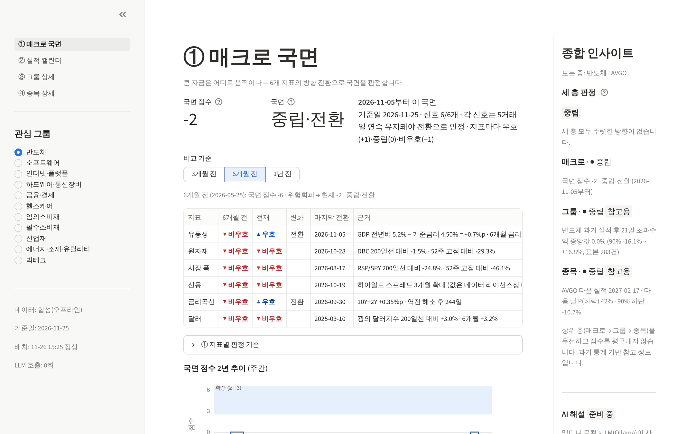
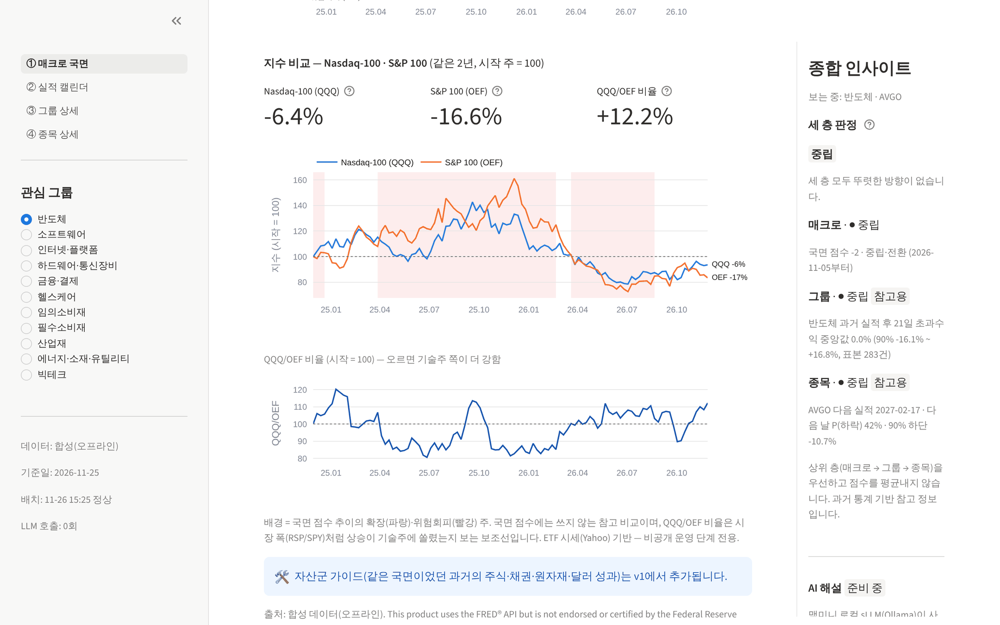
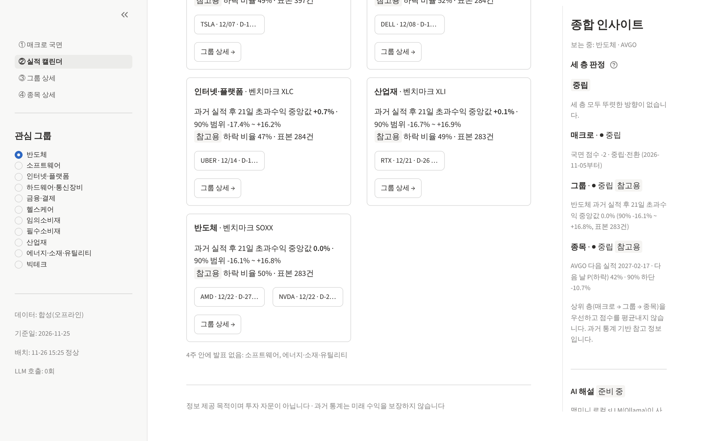
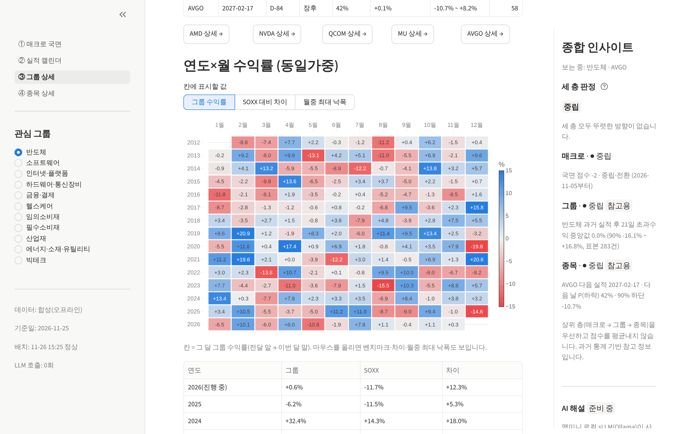
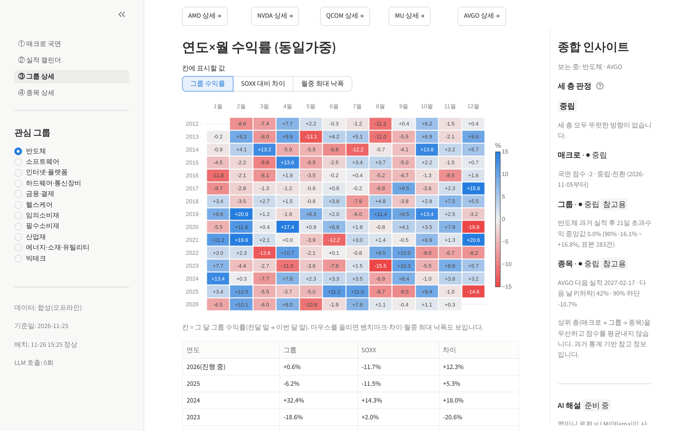
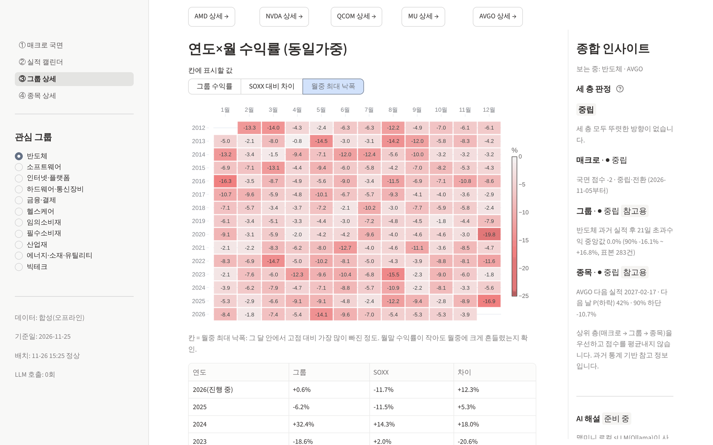
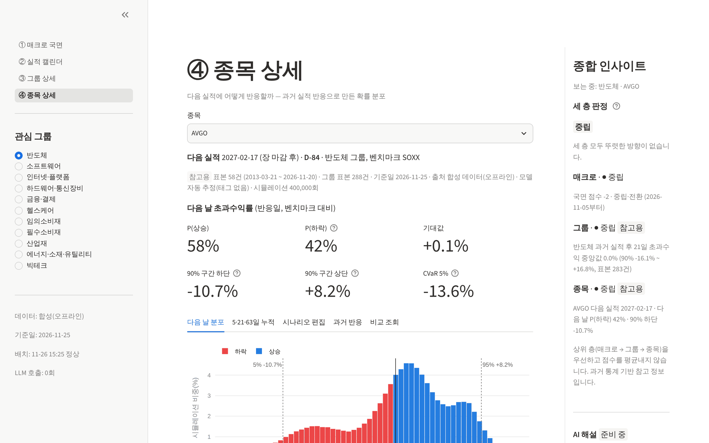
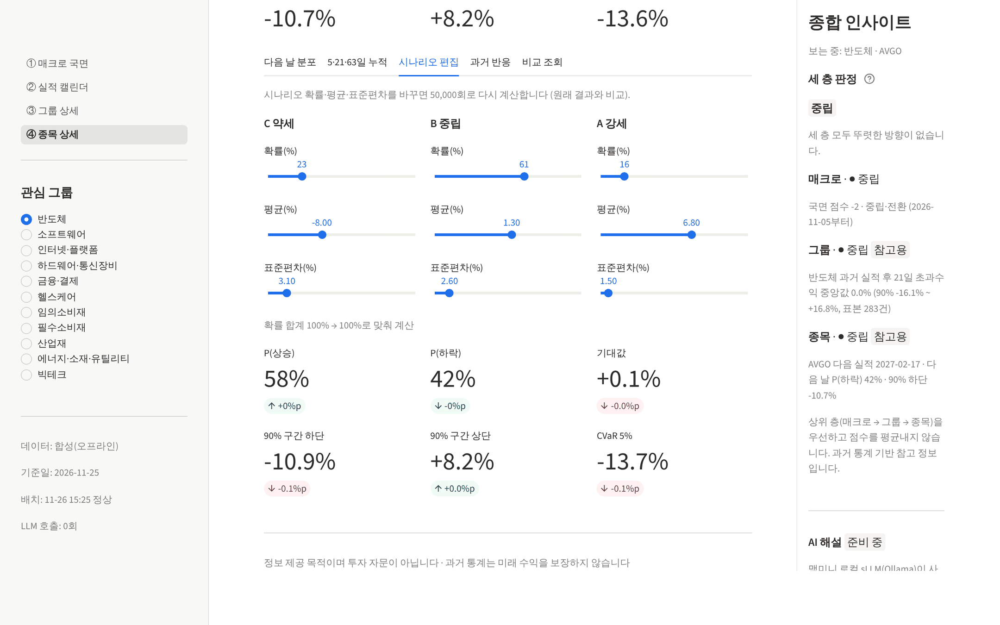
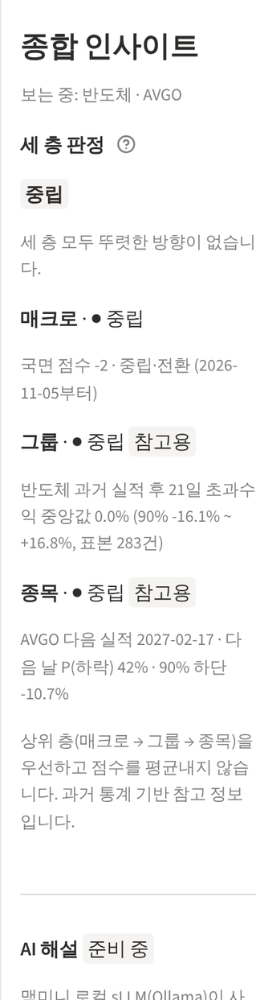

# market.sielain.com 사용 설명서

처음 쓰는 사람이 **5분 안에 화면을 읽고**, **자주 하는 확인을 따라 해 볼 수 있도록** 만든 안내서입니다.
직접 만져 보며 개념을 익히려면 [인터랙티브 가이드](interactive-guide.html)를 브라우저로 여세요 (설치 없이 파일 하나로 동작).

> **먼저 알아둘 것**
> - 이 사이트는 **정보 제공용**입니다. 투자 자문이 아니며, 과거 통계는 미래 수익을 보장하지 않습니다.
> - 모든 확률·분포는 **과거 실적 반응**으로 만든 것입니다. 백테스트 보정(v2) 전이라 모든 수치에 회색 **참고용** 배지가 붙습니다.
> - 아래 예시의 숫자는 설명용이며 실제 시세와 무관합니다.

---

## 1. 접속

1. 브라우저에서 `https://market.sielain.com` 을 엽니다.
2. Cloudflare 로그인 화면에서 등록된 이메일을 입력합니다.
3. 메일로 온 **6자리 코드**를 입력하면 화면이 열립니다. 같은 브라우저에서는 일정 기간 다시 묻지 않습니다.

> 접속 문제: "사이트에 연결할 수 없음"(NXDOMAIN)은 주소 설정 문제, "502 Bad Gateway"는 서버 컨테이너 문제입니다 — 운영자에게 알려 주세요.

---

## 2. 화면 구조 한눈에

```
┌──────────────┬───────────────────────────────────┬──────────────────┐
│ 왼쪽 사이드바 │ 가운데: 지금 보고 있는 화면 ①~④      │ 오른쪽: 종합 인사이트│
│              │                                   │ (항상 보임, 고정) │
│ ① 매크로 국면 │                                   │ 보는 중: 반도체·AVGO│
│ ② 실적 캘린더 │                                   │ [중립]            │
│ ③ 그룹 상세   │                                   │ 매크로 · ● 중립    │
│ ④ 종목 상세   │                                   │ 그룹   · ● 중립    │
│ 관심 그룹 ◉   │                                   │ 종목   · ● 중립    │
│ 데이터·기준일 │                                   │ AI 해설 (v1)      │
└──────────────┴───────────────────────────────────┴──────────────────┘
```

- **순서는 큰 흐름 → 개별 종목**입니다. ① 시장 전체 분위기 → ② 누가 언제 발표하나 → ③ 그 업종은 실적 때 어땠나 → ④ 이 종목은 어떻게 반응할까.
- **왼쪽 아래 상태 줄**
  - `데이터: 실데이터` — 실제 시세로 계산 중 (`합성(오프라인)`이면 시험용 데이터)
  - `기준일` — 마지막으로 계산에 쓴 거래일
  - `배치: 11-27 07:16 정상` — 매일 07:15 KST 자동 계산 결과 (`일부 누락`이면 일부 종목 시세를 못 받아 전날 결과 유지)
  - `LLM 호출: 0회` — 화면을 볼 때 AI를 부르지 않습니다
- **ⓘ 물음표 아이콘**에 마우스를 올리면 용어 설명이 나옵니다.

---

## 3. 5분 둘러보기 (처음 한 번)

| 순서 | 할 일 | 볼 것 |
|---|---|---|
| 1 | **①** 화면 맨 위 국면 점수와 국면을 본다 | 지금 시장이 위험자산에 우호적인가 |
| 2 | **①** 비교 기준을 `1년 전`으로 바꿔 본다 | 표에서 "전환" 표시가 생긴 지표 |
| 3 | **②**에서 기간 `4주`를 고른다 | 곧 실적을 발표하는 그룹과 종목 |
| 4 | 관심 있는 종목 칩(예: `AVGO · 12/09 · D-14 장후`)을 누른다 | **④**로 이동 |
| 5 | **④** 확률 카드 6개와 분포 그림을 본다 | 다음 날 오를 확률, 손실 쪽 꼬리 |
| 6 | 오른쪽 **종합 인사이트** 패널의 배지를 본다 | 매크로·그룹·종목이 같은 방향인지 |

---

## 4. 화면별 사용 설명

### ① 매크로 국면 — 큰 자금은 어디로 움직이나



**무엇을 보여주나**: 6개 지표를 매일 우호(▲, +1)·중립(●, 0)·비우호(▼, −1)로 판정하고 더한 **국면 점수**(−6~+6).

| 지표 | 쉽게 말하면 | 우호 조건 (요약) |
|---|---|---|
| 유동성 | 경제 성장 속도가 금리보다 빠른가 | GDP 전년비 − 기준금리 ≥ 0.5%p, 금리 동결·인하 |
| 원자재 | 원자재 가격이 오르는 흐름인가 | DBC가 200일 평균보다 1% 넘게 위 |
| 시장 폭 | 소수 대형주만 오르는 게 아닌가 | 동일가중/시총가중(RSP/SPY)이 200일 평균보다 1% 넘게 위 |
| 신용 | 위험한 회사채의 추가 금리가 줄고 있나 | 하이일드 스프레드 3개월 0.1%p 넘게 축소 |
| 금리곡선 | 장단기 금리 역전이 끝나고 안정됐나 | 역전 해소 6개월 후 10Y−2Y ≥ 0.25%p |
| 달러 | 달러가 약해지는 흐름인가 | 광의 달러지수가 200일 평균보다 1% 넘게 아래 |

**읽는 법**
- 점수 **+3 이상 = 확장**, **−3 이하 = 위험회피**, 그 사이 = 중립·전환.
- 각 신호는 **5거래일 연속** 같은 판정이 나와야 바뀝니다. 하루 이틀의 흔들림은 무시합니다.
- 이 화면의 핵심은 **수준이 아니라 방향 전환**입니다. 그래서 "비교 기준" 열과 "마지막 전환" 날짜가 중요합니다.

**해 보기**
- 비교 기준을 `3개월 전` → `6개월 전` → `1년 전`으로 바꾸며 "전환"이 몇 개 생기는지 보세요. 짧은 기간에 전환이 많으면 국면이 바뀌는 중일 수 있습니다.
- 표 아래 **ⓘ 지표별 판정 기준**을 펼치면 각 지표의 기준이 나옵니다.

**지수 비교 (Nasdaq-100 · S&P 100)**


- 2년 추이 아래에 같은 기간·같은 날짜축으로 **QQQ(Nasdaq-100)·OEF(S&P 100)** 를 시작 주 = 100으로 그립니다. 배경의 파란·빨간 칸은 국면 점수가 확장·위험회피였던 주입니다.
- 읽는 법: 빨간 칸(위험회피)에서 지수가 실제로 빠졌는지, 국면이 바뀐 뒤 어느 지수가 먼저 움직였는지 봅니다.
- **QQQ/OEF 비율**이 오르면 기술주 쪽이 대형주 전체보다 강했다는 뜻 — 상승이 일부 업종에 쏠렸는지 보는 보조선입니다(국면 점수에는 안 씀).

**예시** — 점수 −2, 6개월 전 −6
> 6개월 전에는 6개 지표가 모두 비우호(위험회피)였는데, 지금은 유동성·금리곡선이 우호로 돌아서 중립·전환 국면입니다. 방향은 개선 쪽입니다.

### ② 실적 캘린더 — 이번 달 누가 발표하나



**무엇을 보여주나**: 고른 기간(2·4·12주) 안에 실적 발표가 있는 그룹을 카드로, 가장 먼저 발표하는 그룹부터.

**카드 읽는 법**
- `과거 실적 후 21일 초과수익 중앙값 +1.8% · 90% 범위 −14.8% ~ +16.0%` — 그 그룹 종목들이 **과거** 실적 발표 후 21거래일 동안 벤치마크보다 얼마나 더/덜 올랐는지의 통계입니다. 다가오는 실적의 예측이 아닙니다.
- `하락 비율 43% · 표본 281건` — 과거 281번 중 43%는 21일 동안 벤치마크보다 못했다는 뜻.
- 칩 `GS · 12/07 · D-12 장후` — 종목·발표일·남은 날·발표 시점(장전=개장 전, 장후=마감 후).

**해 보기**
- 칩에 마우스를 올려 다음 날 P(하락)를 보고, 눌러서 ④로 이동하세요.
- `그룹 상세 →`를 누르면 ③으로 이동하고 사이드바 관심 그룹도 바뀝니다.

### ③ 그룹 상세 — 이 업종은 실적 시즌에 어떻게 움직였나



**누적 초과수익률(CAR) 그림 읽는 법**
- 가로축 0 = 실적 **반응일**(장후 발표면 다음 날, 장전 발표면 당일). −5는 발표 5거래일 전.
- 진한 선 = 과거 모든 발표의 **평균** 경로, 옅은 띠 = 가운데 50%(25~75%)가 지나간 범위.
- 띠가 넓을수록 발표마다 결과가 크게 달랐다는 뜻입니다.

**연도×월 히트맵**


- 칸의 숫자 = 그 달 그룹 수익률(%). 그룹 수익률 = 구성 종목 월수익률의 **단순 평균**(동일가중).
- 아래 표의 "차이" = 그룹 − 벤치마크. 올해는 진행 중인 값입니다.
- **칸에 표시할 값**을 바꿀 수 있습니다: `그룹 수익률` / `벤치마크 대비 차이`(%p, 파랑 = 벤치마크보다 강함) / `월중 최대 낙폭`. 칸에 마우스를 올리면 그룹·벤치마크·차이·월중 최대 낙폭이 한꺼번에 보입니다.



> **왜 "월중 최대 낙폭"이 따로 있나** — 칸의 월수익률은 전달 말 종가 → 이번 달 말 종가 한 번의 변화입니다. 10월 말 100 → 11월 중순 78(−22%) → 11월 말 95라면 칸에는 **−5.0%** 만 남습니다. 그 달 안에서 얼마나 흔들렸는지는 월중 최대 낙폭(−22%)으로 봅니다.
- 주의: **현재 구성 종목 기준**이라 과거 시점의 실제 업종 구성과 다를 수 있습니다.

**해 보기**
- 사이드바에서 관심 그룹을 `필수소비재`로 바꾸고 반도체와 CAR 띠 폭을 비교해 보세요. 업종마다 실적 충격의 크기가 다릅니다.

### ④ 종목 상세 — 다음 실적에 어떻게 반응할까



**확률 카드 6개**

| 카드 | 뜻 | 예시 값의 해석 |
|---|---|---|
| P(상승) / P(하락) | 실적 다음 날 벤치마크보다 오를/내릴 확률 | 58% / 42% |
| 기대값 | 시뮬레이션 평균 | +0.1% — 평균적으로 거의 0 |
| 90% 구간 하단·상단 | 가운데 90%가 들어가는 범위 | −10.7% ~ +8.2% |
| CVaR 5% | 가장 나쁜 5% 경우들의 평균 | −13.6% — 나쁠 때는 이 정도 |

> 손실 쪽 숫자(하단·CVaR)를 기대값과 **같은 크기**로 보여줍니다. 기대값이 0 근처여도 꼬리 위험은 클 수 있습니다.

**탭 5개**
1. **다음 날 분포** — 막대 그림(빨강 하락·파랑 상승). 아래 표 = 약세·중립·강세 세 시나리오의 확률·평균·척도.
2. **5·21·63일 누적** — 실적 후 시간이 지날수록 범위가 넓어지는 모양(팬 차트)과 기간별 표.
3. **시나리오 편집** — 슬라이더로 "강세 확률을 더 높게 보면?" 같은 가정을 넣어 보세요. 5만 회 다시 계산해 원래 값과의 차이(%p)를 보여줍니다. 저장되지 않는 연습용입니다.
4. **과거 반응** — 최근 24번의 실적: 발표일, 장전/장후, 다음 날 수익률, 초과수익, 5·21일 누적, EPS 서프라이즈.
5. **비교 조회** — 다른 종목과 핵심 수치를 한 표로.



### 종합 인사이트 — 오른쪽 고정 패널



**무엇을 하나**: 지금 보고 있는 것을 **매크로 → 그룹 → 종목** 세 층으로 겹쳐 같은 방향인지 보여줍니다. 규칙으로 계산하며 AI를 쓰지 않습니다.

| 배지 | 뜻 |
|---|---|
| 파랑 **일치 — 위험자산 우호** | 자료가 있는 층이 모두 우호 |
| 빨강 **일치 — 위험자산 비우호** | 자료가 있는 층이 모두 비우호 |
| 주황 **충돌 — ○○ 우선** | 위 층과 아래 층이 반대 방향 → 위 층을 우선해 읽음 |
| 회색 **부분 일치 / 중립** | 일부만 방향이 있거나, 뚜렷한 방향이 없음 |

- **보는 중**: ④에서는 그 종목과 산업 그룹. 다른 화면에서는 사이드바 관심 그룹(+ 마지막으로 본 종목이 같은 그룹이면 함께).
- **점수를 평균내지 않습니다.** 평균은 "매크로는 나쁜데 종목은 좋다" 같은 충돌을 숨기기 때문입니다.
- **AI 해설**은 v1에서 연결됩니다(맥미니 로컬 AI가 사이트 수치와 용어 설명만 근거로 답함).

---

## 5. 기능별 예시 — 이렇게 활용하세요

### 예시 A. "AVGO 실적 전에 위험을 점검하고 싶다"
1. ② 기간 `4주` → 반도체 카드의 `AVGO` 칩 클릭
2. ④ 카드에서 **90% 하단**과 **CVaR**을 먼저 봅니다 (예: −10.7%, −13.6%).
3. **과거 반응** 탭에서 최근 실적들의 다음 날 수익률이 이 범위 안에 들어왔는지 확인합니다.
4. 오른쪽 종합 인사이트에서 매크로·그룹과 같은 방향인지 봅니다.
> 읽기 예: "다음 날 하락 확률 42%, 나쁜 5% 경우 평균 −13.6%. 매크로·그룹은 중립이라 종목 고유 요인이 결과를 좌우하는 구간."

### 예시 B. "매크로는 비우호인데 이 종목은 좋아 보인다"
- 종합 인사이트 배지가 주황 **충돌 — 매크로 우선**으로 나옵니다.
- 이때는 ①로 가서 어떤 지표가 비우호인지, 최근 전환이 있었는지 확인하세요. 종합 규칙은 큰 흐름(매크로)을 먼저 읽습니다.

### 예시 C. "이 업종이 실적 시즌마다 어땠는지 알고 싶다"
1. 사이드바 관심 그룹 선택 → ③
2. CAR 그림: 0일 이후 평균 선이 위로 가는지, 띠가 얼마나 넓은지
3. 21일 요약 카드: 중앙값·하락 비율·표본 수 (표본이 적으면 해석에 주의)

### 예시 D. "강세 시나리오를 더 크게 보면 어떻게 바뀌나"
1. ④ → **시나리오 편집**
2. `A 강세` 확률을 16% → 30%로 올립니다 (합계는 자동으로 100%로 맞춰 계산)
3. P(상승)·기대값의 변화(%p)와 함께 **90% 하단이 어떻게 바뀌는지**도 보세요.

### 예시 E. "국면이 바뀌는 중인지 알고 싶다"
- ① 비교 기준 `3개월 전`에서 "전환"이 2개 이상이고, 2년 추이 그래프가 띠(확장/위험회피) 경계를 넘나들면 전환기일 가능성이 있습니다.

---

## 6. 자주 묻는 질문

**Q. 숫자가 매일 조금씩 바뀌어요.** 매일 07:15 KST에 최신 시세로 다시 계산합니다. 기준일은 왼쪽 아래에 있습니다.

**Q. "참고용" 배지는 왜 항상 붙나요?** 예측이 실제로 얼마나 잘 맞았는지 검증(백테스트 보정)하는 기능이 v2 예정이라, 그 전까지는 모든 확률을 참고용으로 표시합니다.

**Q. 신용 지표는 왜 값이 안 보이나요?** 원 데이터(ICE BofA)는 제3자에게 값을 공개하면 안 되는 조건이라 방향(축소/확대)만 보여줍니다.

**Q. "일부 누락"이 떠요.** 그날 일부 종목의 시세를 받지 못했다는 뜻입니다. 그 종목은 전날 계산 결과가 그대로 보이고, 다음 날 자동으로 다시 시도합니다.

**Q. 뉴스에서는 Nasdaq이 이번 달 20% 넘게 빠졌다는데 ③ 히트맵 칸은 작아요.** 다섯 가지를 확인하세요.
1. ③은 지수가 아니라 **고른 그룹 5종목의 동일가중 평균**입니다. 지수 자체는 ① 지수 비교(QQQ)에서 보세요.
2. 칸은 **월말 대비 월말**입니다. 월중 고점 대비 하락은 `월중 최대 낙폭`으로 전환해서 보세요.
3. 이번 달은 **기준일까지**의 값입니다(왼쪽 아래 기준일).
4. 왼쪽 아래가 `데이터: 합성(오프라인)`이거나 README·가이드의 캡처를 보고 있다면 예시 숫자입니다.
5. "20%"가 어느 시점부터의 하락인지(전달 말인지, 이번 달 고점인지) 기준을 맞춰 보세요.

**Q. 장전·장후가 왜 중요한가요?** 장 마감 후(장후) 발표면 시장 반응은 **다음 거래일**에, 개장 전(장전) 발표면 **당일**에 나타납니다. 반응일을 정확히 잡아야 반응 크기를 제대로 잴 수 있습니다.

---

## 7. 용어

| 용어 | 뜻 |
|---|---|
| 초과수익률 | 종목 수익률 − β × 벤치마크(그룹 ETF) 수익률. 시장 전체 움직임을 뺀 종목 고유의 반응 |
| 반응일 | 실적이 주가에 처음 반영되는 거래일 (장후 → 다음 날, 장전 → 당일) |
| CAR | 누적 초과수익률. 실적일 전후 여러 날의 초과수익을 더한 값 |
| 90% 구간 | 결과의 가운데 90%가 들어가는 범위 (5% ~ 95% 위치) |
| CVaR 5% | 가장 나쁜 5% 경우들의 평균 손실 |
| 시나리오(약세·중립·강세) | 과거 반응을 세 무리로 나눈 것. 데이터에서 자동 추정 |
| 국면 점수 | 6개 매크로 지표의 우호(+1)·중립(0)·비우호(−1) 합 |
| 동일가중 | 그룹의 모든 종목에 같은 비중을 주는 방식 |
